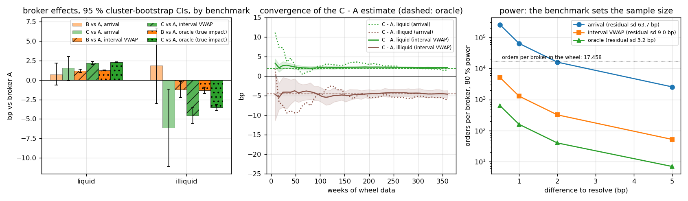
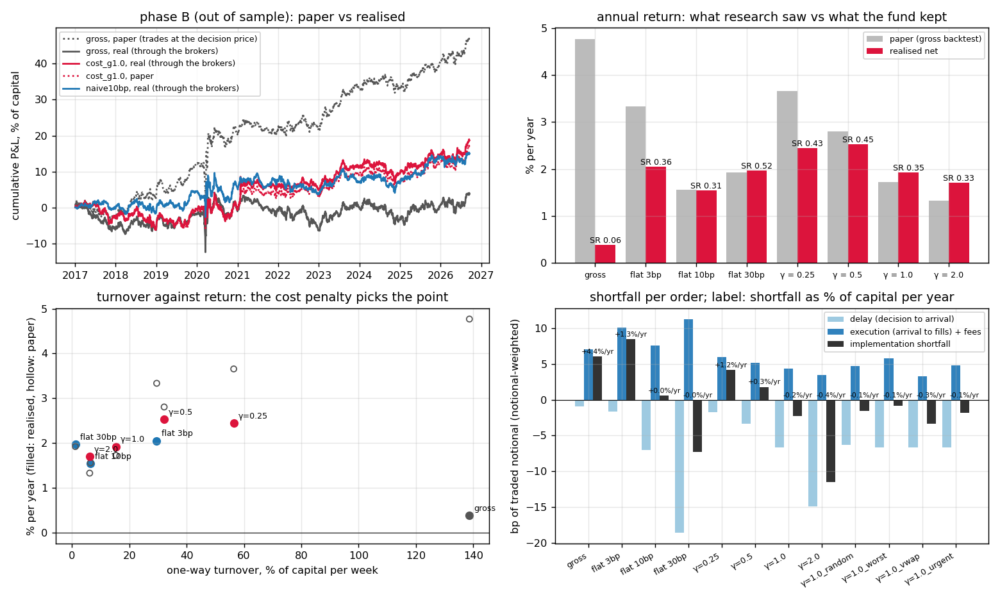

# algo-wheel

A randomised broker algo wheel, a square-root pre-trade cost model and a cost-aware portfolio optimiser, tested on a walk-forward equity signal for 156 US large caps. Brokers, fills and impact are simulated at the scale of Almgren et al. (2005); prices, volumes and volatilities are real.

The question: a research team hands the desk a signal with a gross backtest. Which broker should the desk route to, what will an order cost, and how much of the gross return survives?

## Results

- **The benchmark decides whether the wheel can work.** Against arrival price an order's cost has a residual sd of 64 bp, and resolving a 1 bp broker difference at 80 % power needs 63,775 orders per broker. The seven-year wheel had 17,458 orders and could not separate brokers in liquid names. Against interval VWAP the sd is 9 bp and 1,283 orders suffice. The same orders give A cheapest in liquid names (B +1.18 bp [1.00, 1.38], C +2.20 [2.02, 2.38]) and C cheapest in illiquid ones (−4.58 [−5.57, −3.57]).
- **Routing by that map is worth 1.0 % of capital a year on the gross book** (+0.38 % against −0.66 % at random). Randomising for seven years costs $84m against oracle-best routing; Thompson sampling per stratum costs $8m.
- **The pre-trade model explains almost nothing per order and is still calibrated.** Out-of-sample R² is 0.01 against 60–90 bp of noise, but the decile calibration holds (predicted 20.7 bp, realised 22.4 ± 2.2). Against the oracle the square-root law explains 82 %. Fitted impact is 0.25 on observed costs and 0.16 on the oracle, so the desk overstates impact by half.
- **Putting the cost model inside the optimiser lifts realised return from 0.4 % to 1.9 % a year.** The gross book earns 4.8 % on paper (Sharpe 0.79) and 0.4 % for real, because 139 % weekly turnover at 6 bp an order costs 4.4 % of capital a year. At the γ = 1 chosen on 2010–2016, turnover falls to 15 % a week and realised return is 1.9 % (Sharpe 0.35).

| out of sample, 2017–2026 | paper %/yr | realised %/yr | turnover %/wk |
|---|---|---|---|
| gross, best routing | 4.77 | 0.38 | 139 |
| flat 10 bp | 1.56 | 1.54 | 6 |
| γ = 0.5 | 2.81 | 2.53 | 32 |
| γ = 1 (chosen) | 1.73 | 1.92 | 15 |




All numbers are in `results/summary.md`; the detail is in [docs/method.md](docs/method.md).

## How it works

- **Signal.** Eight rank-normalised price and volume features, ridge plus gradient boosting refitted each January. Alpha is half the in-sample IC times volatility times the z-score.
- **Market.** A Brownian bridge from the real open to the real close, real volume on a U-shaped curve, and three brokers with different impact and spread capture. Every fill carries its impact-free oracle.
- **Wheel.** Orders are dealt to brokers within six strata. Costs are regressed with broker effects and a cluster bootstrap over days, with power analysis and Thompson sampling.
- **Optimiser.** Mean-variance with a convex cost penalty from the fitted pre-trade model (cvxpy, Clarabel). A flat cost per unit turnover is the naive alternative.
- **Two books.** A paper book at decision prices and a real book at fills. Their NAV gap equals the summed implementation shortfall to the cent.

## Limitations

- Brokers and fills are simulated, and the broker-by-liquidity interaction is an assumption.
- The universe is today's large caps, so gross return has survivorship bias. The paper-versus-real gap is affected little.
- No financing or borrow costs, and the optimiser is single-period.
- Realised beats paper at low turnover partly because the reversal signal keeps moving between Friday's close and Monday's open. That is a property of the signal, not of execution.

## Run

```
pip install numpy pandas pyarrow scipy scikit-learn cvxpy clarabel matplotlib pytest
scripts/run_all.sh            # about 25 minutes; add --quick for about 6
```

CI runs the 16 tests and the quick pipeline.
